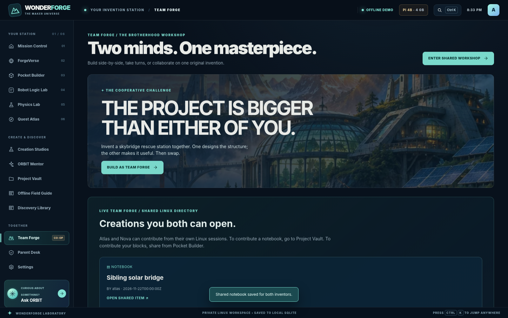

# WonderForge OS 2027 · Engineering Edition 0.7

**An installable, offline-first invention station for one shared Raspberry Pi 4 Model B (4 GB RAM).** Built for two home-educated brothers, age 11 and 13, with individual Linux logins and a consciously shared project space. This edition moves beyond a browser-only demonstration to include an actual per-user portal service, filesystem permissions, an app-launch backend, account provisioning, a native Debian package, an original playable-content Luanti worldmod, and optional UID-based offline enforcement.


## v0.7: ORBIT runs an optional LOCAL language model (23 November 2026)

**Generative inference is now implemented as an optional feature**, integrated with the existing safe launcher and per-user portal. An adult must separately install Ollama for Linux ARM64, configure its localhost-only service, and download a suitable small model. No model weights or third-party AI services are included in the `.deb`. The default, Qwen3 `0.6b`, is an experiment for the existing Pi 4B **4 GB RAM** and still needs measured real-device verification.

ORBIT has a bounded local model planner: at most two turns, two **read-only** app-defined tools, one active model generation, 2048 context tokens, two CPU threads and no shell/network/filesystem/program-launch tools. It can search approved original lessons/quests or calculate idealized physics examples. It can suggest a Maker Journal experiment, but the user must explicitly approve a single-use session-bound proposal; observations and conclusions remain blank until the human performs a test. It transparently falls back to the scripted mentor when local inference is unavailable. The model is fallible and **not** a child-safety filter.

See [adult setup and rollback guide](docs/LOCAL-AI.md), [v0.7 release acceptance gates](docs/RELEASE-GATES-v0.7.md), and [ORBIT source](local_ai.py). The image builder remains optional, since supported Raspberry Pi OS is already installed.

## v0.6: inquiry, evidence, and observable hardware (23 November 2026)

**New Maker Journal:** Each inventor can document a question, hypothesis, repeatable test, measurements/observations, conclusions and next iteration. Entries link to quests, are kept in the per-user SQLite-backed state, and support validated import/export. Completing a journal record never claims to verify scientific correctness.

**New System Pulse:** The authenticated read-only `/api/health` endpoint reports actual RAM availability, CPU load, thermal sensor (when exposed), storage free space and Pi throttling register (when available). It explicitly identifies development hosts and never manufactures frame rates. These reports remain localhost-only and are not sent to any service.

The v0.6 source repository also adds stricter CI, new security and contribution guidelines, installation disclosures and automated tests for the new capabilities.

## v0.5 security and learning changes (23 November 2026)

This release fixes a serious v0.4 localhost trust error: **different TCP ports are not user authentication**. Only the per-child `wonderforge-launch` flow now creates a short-lived, single-use signed ticket and authenticates all production `/api/*` requests with an HttpOnly SameSite cookie. Each child's personal work is persisted in a private Linux-user-owned SQLite database instead of relying solely on browser cache. The developer demo `python3 server.py` remains unauthenticated and must **not** be used as secure family account separation.

**New interactive lessons:** two transparent idealized STEM models (LED/resistor and elastic beam), 18 original offline field-guide experiments, and ORBIT's local source-identified lesson retrieval. They complement the 20 maker quests, isometric building sandbox and logic-programming robot. These math tools do **not** certify safe electrical or structural designs.

**Real deployment:** opt-in standard Linux accounts, a group-owned Team Forge folder, an allowlisted app launcher, an original Luanti worldmod and the Debian `.deb` all remain. Custom-image firstboot now only stages files; an adult must create the OS administrator and deliberately provision children. New read-only Pi resource sampling, SHA-256 backup receipts, and an archive inspector assist hardware verification and recovery.

**Previous results:** 35 Python tests, native JavaScript/terminal syntax and browser simulation passed on the development host. No physical Pi installation, Luanti gameplay, performance benchmark or custom `.img` boot has been verified.

See [v0.6 release notes](docs/RELEASE-NOTES-v0.6.md) and [v0.5 release notes](docs/RELEASE-NOTES-v0.5.md), [family quickstart](docs/QUICKSTART-FAMILY.md), [security](docs/SECURITY-AND-FAMILY.md), [performance](docs/PERFORMANCE-v0.5.md) and [recovery](docs/RECOVERY-v0.5.md).



## What exists, and what does not

**Runnable and tested in this development environment:** the complete Reforged desktop/browser portal, 20 maker quests, six regions, 12×12×8 block blueprint editor, executable robot-programming puzzle, notes, local user-specific data, shared notebook/blueprint HTTP API, security checks on requests, application allowlist and UI wiring. The Python and JavaScript code are executed by automated tests. The installer and image-builder safe/dry-run modes execute without touching the host OS.

**Packaged and configured but not physically verified:** Raspberry Pi account provisioning, optional installed applications, group-owned shared directory, optional outbound network blocking with nftables, XDG desktop integration, the Luanti in-world island generator and quests, and ARM64 first-boot image-builder hooks. These depend on a real Raspberry Pi 4B with Raspberry Pi OS Trixie 64-bit. Source inspection and browser simulation are **not** proof of successful Pi boot, compatible graphics/audio, or real gameplay.

**Not delivered:** a physically boot-tested and flashable custom `.img`, a pretrained local model weight bundle or hardware-validated generative inference, a comprehensive child-safe content filtering product, a visually photorealistic 3D MMORPG, predownloaded third-party game worlds, or measured Pi-4 frame rates. Those are distinct engineering and hardware verification problems, not checkboxes to mark as done.

## Choose a deployment method

**Option A — recommended: Start from official Raspberry Pi OS Desktop 64-bit.** On a *spare* SD card or SSD, use Raspberry Pi Imager to install the official Pi OS. Complete adult-account setup and first boot. Transfer this project to the Pi and use the dry-run-first installer:

```bash
bash installer/system-install.sh
sudo bash installer/system-install.sh --apply --admin-user=YOUR_EXISTING_ADMIN --autostart
sudo passwd atlas
sudo passwd nova
sudo bash installer/install-apps.sh --apply
```

Then disable automatic desktop login in `sudo raspi-config` so the brothers select the real Linux account at the login screen. Reboot, log in to `atlas` or `nova`, and launch WonderForge from Applications (or let the optional per-user autostart run). **Do not run `--apply` from this ChatGPT container**; it intentionally refuses non-Pi hardware. Read the complete [Pi deployment guide](docs/PI4-INSTALLATION.md) before installation.

**Option B — Debian package, to install the app payload without creating accounts automatically:**

```bash
sudo apt install ./wonderforge-os_0.7.0_all.deb
sudo bash /opt/wonderforge/installer/system-install.sh --apply --admin-user=YOUR_EXISTING_ADMIN
sudo passwd atlas
sudo passwd nova
```

You can install the approved games/apps and optional autostart separately. The `.deb` is architecture-independent Python, JavaScript, and assets, with no native compiled binaries; **the actual target for provisioning is still a Pi 4B/ARM64**. Do not place the `.deb` inside `/opt/wonderforge` to avoid confusing source and destination.

**Option C — prototype only** on Windows, Linux or macOS (no OS changes):

```bash
python3 server.py
# Visit http://127.0.0.1:8765/ on the same machine
```

This option is a full-featured browser demo. The graphical workshop chooser is not authentication, and browser-local progress can be lost when browsing data is cleared. When a separately installed local Ollama model is detected, ORBIT can use it here too; that does not make the demo secure multi-user software. No package installs are attempted.

### Quick visual preview on Windows — no Pi required

1. Download this repository as a ZIP from GitHub (**Code → Download ZIP**) and **Extract All**.
2. Install Python 3.11 or later on Windows if needed. You do not need Linux, WSL, Ollama, Git, a `.deb`, or administrator privileges.
3. Open the extracted repository folder and double-click `start-windows.bat`. It starts a localhost-only web server and opens the prototype in your browser.
4. If the browser does not open automatically, visit **http://127.0.0.1:8765/** yourself. Keep the command window open while exploring; close it or press **Ctrl+C** to stop.
5. Choose Atlas, Nova, or Team Forge. Explore Mission Control, ForgeVerse, Pocket Builder, Robot Logic Lab, Physics Lab, Maker Journal, ORBIT, and Settings. ORBIT uses scripted guidance if Ollama is not installed.

This is an **interactive visual preview**, not a secure Windows account system. It does not install anything, modify Raspberry Pi OS, or launch Pi-native apps. Browser-stored demonstration data may be lost if browsing storage is cleared.

If Windows blocks the batch file or you prefer the terminal, open PowerShell in the extracted folder and run `py -3 server.py` (or `python server.py`).

**Option D — experimental custom image:** `bash image/build-image.sh` previews the image recipe, and `bash image/build-image.sh --build` attempts the pinned official `rpi-image-gen` workflow on a capable native ARM64 build host. Its base desktop package, adult login, boot, first-boot app-staging flow and GPU compatibility **have not been tested on hardware**, so do not use the resulting image as the family's only boot medium. See [the image build guide](docs/IMAGE-BUILD.md).

## Why separate Linux users?

The original prototype's three beautiful portraits were *localStorage namespaces*, not security boundaries. In the installed version, the backend supplies the Unix identity. An `atlas` desktop session stays Atlas and a `nova` desktop session stays Nova—even if the page tries to switch its visual workspace. `/home/atlas` and `/home/nova` are private (`0700`). Only a deliberate copy of a project or blueprint becomes readable by the brother in `/srv/wonderforge/team` (group `wonderforge`, permissions `2770`). The adult administrator retains system control.

One Pi remains one Pi: there is no claim of two simultaneous local display sessions, dual-seat gameplay, or a multiplayer LAN server. Team Forge is for taking turns and collaborating on creations with actual shared file exchange.

## The first real adventure inside Luanti

Every child gets an independent `~/.minetest/worlds/WonderForge` world, not a world shared over the LAN. The included `worldmods/wonderforge/init.lua` defines custom low-resolution materials and six floating islands around the Invention Station: **Sky Citadel, Robot Wilds, Crystal Deep, Red Frontier, Echo Isles, and Code Garden**. Mapgen generates a hub, bridges, luminous markers and portal nodes as mapchunks appear; the quest atlas stores six in-game challenge completions by player name. Right-click the Atlas object or type `/forge`. Use `/forgehome` to return to the central hub. **A real Luanti 5.10 runtime is required to confirm rendering, performance and mapgen behavior.** [World instructions](docs/LUANTI-WORLD.md).

## Approval-based launcher

The Python service binds to loopback (`127.0.0.1`) on a **different port per Unix UID**, so Atlas and Nova do not collide if both sessions happen to remain active. It serves fixed files and only a few bounded API routes. Creation Studios offers a real launch action only for recognized installed binaries, from a **fixed allowlist** such as Luanti, Thonny, Inkscape, Krita, GIMP, OpenSCAD and Stellarium. A click requires confirmation; no arbitrary filenames, shell snippets or network commands are accepted. Launching is disabled for root and requires a graphical desktop. A successful launch response means a process was requested, not proof that a working application window opened.

The team-sharing API checks JSON type and size, validates blueprint coordinates/materials, requires matching local `Origin`, rejects foreign hosts and cross-site write requests, and opens records without following symlinks. It is **not an Internet-facing service**. It is designed for trusted people with local Linux accounts, not against malicious root access or fully compromised browsers.

## Optional outbound network guard

Once installed applications and approved reference materials have been obtained, the adult may run:

```bash
sudo bash installer/offline-guard.sh       # review, no changes
sudo bash installer/offline-guard.sh --apply
```

This creates a persistent `nftables` policy that rejects **outbound non-loopback traffic made by the `atlas` and `nova` Linux UIDs**. This blocks those users' normal Internet/LAN connections; adult admin networking remains available. Removing it is deliberate:

```bash
sudo bash installer/offline-guard.sh --apply --remove
```

This is a meaningful technical boundary, **not** complete filtering, time-limit management or an assertion that a child cannot find any bypass. It also blocks child-owned LAN multiplayer and external AI endpoints. Read [security and family policy](docs/SECURITY-AND-FAMILY.md).

## Architecture at a glance

```text
Raspberry Pi OS Trixie 64-bit  ·  normal graphical login
 ├─ Linux adult administrator: privileged maintenance, backups, network setup
 ├─ Linux atlas: 0700 home  ·  private Chromium profile  ·  local Python service
 ├─ Linux nova:  0700 home  ·  private Chromium profile  ·  local Python service
 ├─ Group wonderforge: /srv/wonderforge/team, explicit copied JSON records
 ├─ WonderForge web UI: 15 experiences, scripts, quests, editors, ORBIT
 ├─ Approved desktop applications: actual APT packages, launched by allowlist
 ├─ Luanti worldmods: 6 islands, game quests, custom textures, singleplayer
 ├─ Optional ORBIT: small local Ollama model + read-only tools + human approved journal drafts
 └─ Optional nftables: per-child-UID non-loopback output blocking
```

This keeps the operating system and driver stack supported by Raspberry Pi OS instead of inventing an incompatible custom kernel or consuming Pi 4 RAM with a heavyweight desktop replacement.

## Verification / trust boundary

```bash
python3 -m unittest discover -s tests -v
node --check web/app.js && node --check web/labs.js && node --check web/journal.js
bash -n installer/*.sh scripts/*.sh image/*.sh
python3 tools/verify_linux_ui.py       # requires development Chromium + Playwright
python3 tools/pi4-audit.py             # read-only checks, run ON THE ACTUAL Pi
```

The Pi audit deliberately reports failure here for the missing Pi hardware/accounts; that is correct. A passing test suite on x86_64 does not mean the physical Pi is validated.

## Project files

- `local_ai.py` — fixed-loopback Ollama gateway and bounded read-only agent planner
- `installer/setup-local-ai.sh` — dry-run-first adult configuration for offline model inference
- `tools/benchmark-local-ai.py` — on-device model latency and hardware observations
- `device_health.py` — honest read-only Pi resource sampling
- `web/journal.js` — validated experiment evidence records and import/export
- `server.py` — localhost server, bounded team sharing and approved program launch
- `web/`, `data/`, `design/` — existing premium UI, local assets and curricular content
- `installer/system-install.sh` — guarded dry-run-first system provisioner
- `installer/install-apps.sh` — apt approved core/extras, dry-run first
- `installer/offline-guard.sh` — optional UID-bound blocking, reversible
- `installer/uninstall.sh` — uninstall without deleting personal creations
- `scripts/wonderforge-launch` — opens normal Chromium application window without disabling the browser sandbox
- `scripts/backup-family.sh` — manual adult backup tool (unencrypted archive; destination must be protected)
- `os/systemd/`, `os/desktop/`, `os/worlds/` — service, desktop launcher, Luanti world
- `image/` — experimental native ARM64 `rpi-image-gen` recipe and first-boot overlay
- `tools/pi4-audit.py`, `tests/` — real acceptance and security checks
- `docs/` — deployment, world, family security, image build, architecture and testing

**Design principle:** One shared Pi should feel like a serious studio where two young inventors learn to make things—not a flashy screen that hides an unimplemented operating system.

**Rebuild the Debian payload:** run `bash scripts/build-deb.sh dist` on a machine with `dpkg-deb` (non-root, no system modifications). The package only suggests creative applications; install them deliberately with `installer/install-apps.sh --apply` after reviewing the preview.

For an adult-friendly installation walkthrough, read [Family Quickstart](docs/QUICKSTART-FAMILY.md). See [the v0.6 acceptance plan](docs/ACCEPTANCE-GATES-v0.6.md) for test evidence and remaining physical-Pi release gates.
